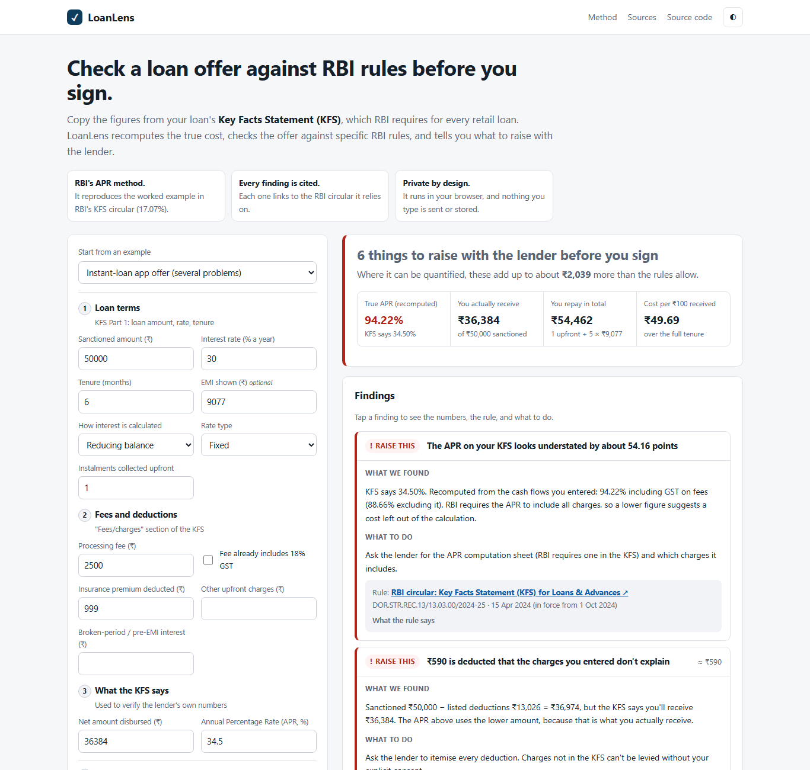

# LoanLens

**Check an Indian loan offer against RBI rules before you sign.**

[](https://github.com/Chickoo123/loanlens/actions/workflows/ci.yml)
[](https://github.com/Chickoo123/loanlens/actions/workflows/codeql.yml)


**[Open LoanLens →](https://chickoo123.github.io/loanlens/)**



## The problem

Since 1 October 2024, RBI has required lenders to give every retail and MSME borrower a **Key Facts Statement (KFS)**. It must show an all-inclusive **Annual Percentage Rate (APR)**, and the lender can't levy a charge the KFS doesn't list. In April 2024, RBI also named specific practices it had found lenders using, and ordered refunds:

- charging interest from the **sanction date** instead of the date the money was disbursed;
- collecting **instalments in advance** but charging interest on the **full** loan amount;
- charging a **full month's interest** for a part-month.

These rules protect borrowers only if someone checks. Checking a KFS means solving an internal rate of return, knowing which circular applies, and spotting subtle schedule tricks, so in practice almost nobody does. That gap is widest in instant-loan apps, where fees, bundled insurance and advance instalments can turn an advertised "30%" into something far higher.

## What LoanLens does

You copy the figures from your KFS into a form laid out in the same order as RBI's KFS template. LoanLens then:

1. **Recomputes the APR** using RBI's method: the monthly IRR on the net amount you actually receive, × 12. It reproduces the worked example in RBI's KFS circular exactly (₹20,000 at 15% for 24 months with ₹400 of charges gives 17.07%). That example is a unit test.
2. **Checks the offer against specific RBI rules**, and shows the arithmetic for each finding:

   | Check | Rule |
   |---|---|
   | Stated APR understates the recomputed APR | KFS circular, Apr 2024 |
   | Deductions the KFS charges don't explain | KFS circular |
   | Flat-rate interest, or a flat-rate EMI presented as reducing balance | KFS circular (APR disclosure) |
   | Advance instalments with interest on the full amount | Fair Practices – Charging of Interest, Apr 2024 |
   | Interest charged from before disbursal | Fair Practices – Charging of Interest |
   | Broken-period interest higher than the days it covers | Fair Practices – Charging of Interest |
   | Pre-payment charge on a floating-rate loan to an individual | Pre-payment Charges Directions, 2025 |
   | Penal *interest* added to the rate instead of a penal *charge* | Penal Charges circular, Aug 2023 |
   | Charges demanded that aren't on the KFS | KFS circular |
   | Digital loan with no cooling-off period of at least one day | Digital Lending Directions, 2025 |

3. **Explains its working.** You can see every deduction from sanctioned amount to money in hand, the APR equation with your numbers, a full amortisation table, and an `=RATE()` formula to verify the result in Excel.
4. **Drafts a letter** to the lender's Grievance Redressal Officer that cites each issue and its RBI reference, with the 30-day route to the RBI Ombudsman.

## Design decisions

- **Every finding carries a status** (*Raise this*, *Confirm*, *Good to know*, *Looks fine*) and only claims what your figures prove. Anything that depends on facts outside the KFS is marked *Confirm*, not *Raise this*.
- **GST ambiguity is handled openly.** RBI's circular doesn't say whether GST on fees belongs in the APR, and lenders differ. LoanLens computes both versions and flags an APR only if it is understated under both.
- **The stronger claim wins.** If the KFS's own net-disbursed figure is lower than its listed charges explain, the APR uses the money you actually receive.
- **No accounts, no uploads, no tracking.** A strict Content-Security-Policy (`connect-src 'none'`) makes network requests impossible, and loan figures are never written to the URL or to storage.
- **It is deliberately not a chatbot.** The value is deterministic arithmetic plus cited rules, both of which have to be right every time.

## Limits

LoanLens can't tell you whether a lender is RBI-registered, can't see terms you don't enter, and isn't legal advice. Rules vary by lender type and change over time. Each source in [`src/rules.js`](src/rules.js) carries the date its summary was last checked, and links to the official RBI page.

## Engineering

- `src/audit.js`: a pure audit engine (cash flows, IRR by bisection, rule checks, letter) with no DOM access.
- `src/rules.js`: the citation registry. Every finding must reference one of its entries, and a test enforces this.
- 18 `node:test` suites, including RBI's worked example, each malpractice with a known-good counter-case, ordering of findings, and validation of impossible inputs.
- Vanilla ES modules, zero runtime dependencies, keyboard-accessible, works on phones, and prints cleanly.
- CI runs tests on Node 20 and 22, CodeQL scans every push, and GitHub Pages deploys after the tests pass.

```bash
npm test          # Node 20+, no install needed
npm run serve     # or: python -m http.server
```

## Related

[PaisaTrail](https://github.com/Chickoo123/paisatrail) applies the same approach to savings accounts: it finds bank charges that conflict with RBI rules.

---

Built by [Harshil Desai](https://github.com/Chickoo123). Not affiliated with RBI or any lender. Not legal or financial advice.
